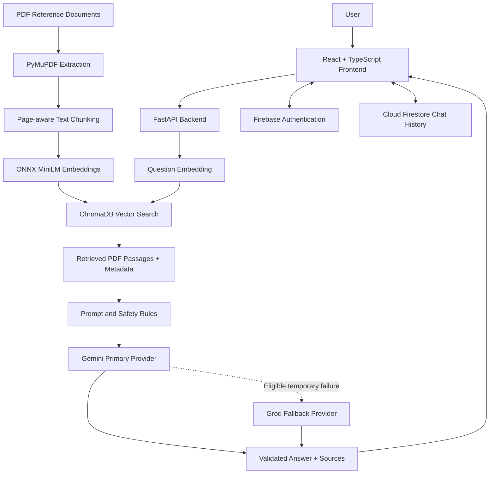

# AyurBot — Ayurveda and Home Remedies Knowledge Bot

<p align="center"><strong>A conversational way to explore Ayurveda and home-remedy references.</strong><br/>
Built with React, FastAPI, Retrieval-Augmented Generation (RAG), ChromaDB, Gemini, Groq and Firebase.</p>

<p align="center">
  
  
  
  
  
</p>

---

## Overview

**AyurBot** is an AI-assisted knowledge application designed to help users explore Ayurveda and home-remedy information contained in a curated set of PDF documents.

Rather than relying only on keyword matching, AyurBot uses **Retrieval-Augmented Generation (RAG)**. It converts document passages and user questions into embeddings, searches ChromaDB for relevant passages, and supplies the retrieved context to a language model to prepare a response.

The application supports a conversational workflow: users can ask a question, view remedy recommendations, select a remedy for a more detailed explanation, and continue with context-aware follow-up questions.

> **Responsible-use notice:** AyurBot is an educational information tool. It does not diagnose medical conditions, prescribe treatment, or replace advice from a qualified healthcare professional. Traditional use does not, by itself, establish clinical effectiveness or safety.

## Key Features

- **Conversational question answering** — ask questions in natural language.
- **PDF-grounded retrieval** — search indexed Ayurveda and home-remedy reference documents.
- **Semantic similarity search** — retrieve passages by meaning, not only exact keywords.
- **Remedy recommendations** — present options when relevant material is found in the knowledge base.
- **Remedy details** — request information about ingredients, preparation, possible benefits, evidence, side effects, contraindications and precautions when supported by the available context.
- **Context-aware follow-up** — continue a discussion with the selected remedy and previous turns.
- **Source-aware responses** — return document name, page and passage identifiers for retrieved material.
- **Gemini with Groq fallback** — use Gemini as the primary model and Groq for eligible temporary provider failures.
- **User authentication** — Firebase Authentication supports account registration and login.
- **Chat history** — Cloud Firestore stores user conversation history.

## Technology Stack

| Layer | Technology | Role |
|---|---|---|
| Frontend | React 19, TypeScript, Vite | Web application and user interface |
| Styling | Tailwind CSS | UI styling |
| Routing | React Router | Frontend navigation |
| Backend | Python, FastAPI, Uvicorn | API and application services |
| RAG support | LangChain Core, LangChain Text Splitters | Document chunking and RAG workflow support |
| PDF extraction | PyMuPDF | Extract text from PDF documents |
| Embeddings | ONNX Runtime, Hugging Face Hub, Tokenizers; `sentence-transformers/all-MiniLM-L6-v2` | Generate 384-dimensional text embeddings |
| Vector database | ChromaDB | Store and retrieve document vectors |
| Primary LLM | Google Gemini API | Generate answers using retrieved context |
| Fallback LLM | Groq API; current configured model `openai/gpt-oss-20b` | Alternative generation for eligible temporary Gemini errors |
| Authentication | Firebase Authentication | User identity and sign-in |
| User data | Cloud Firestore | User profiles and conversation history |

## System Architecture



### RAG workflow

**1. Document ingestion**

1. PDF reference documents are placed in the backend document collection.
2. PyMuPDF extracts the text and page information.
3. The chunker splits page content into smaller passages, retaining source and page metadata.
4. The embedding module generates vectors using the pinned MiniLM ONNX model.
5. ChromaDB stores passage text, vectors and metadata in the `ayurbot_knowledge_base` collection.

**2. Query and retrieval**

1. The user submits a question from the frontend.
2. The frontend sends the request to the FastAPI API.
3. The backend embeds the question with the same embedding model.
4. ChromaDB retrieves the nearest matching passages.
5. Retrieved text and source metadata are assembled into the generation context.

**3. Answer generation**

1. The backend applies grounding and safety instructions to the model prompt.
2. Gemini is called as the primary provider.
3. The provider manager can use Groq when Gemini encounters configured eligible failures, such as quota/rate-limit or temporary service errors.
4. The backend returns the answer, source metadata and error information in the API response.

**4. Remedy interaction**

The remedy workflow supports recommendations, a selected-remedy explanation, and follow-up questions. The backend validates remedy response fields and source metadata. When PDF material is insufficient, the application should state that limitation or clearly distinguish any AI-generated supportive suggestion from PDF-sourced information.

## Repository Structure

The following tree reflects the folders and files currently present in this repository. Generated ChromaDB data and individual PDF names are grouped for readability.

```text
Ayurveda-and-Home-Remedies-Knowledge-Bot/
│
├── backend/
│   ├── .env.example
│   ├── requirements.txt
│   ├── app/
│   │   ├── __init__.py
│   │   ├── main.py                      # FastAPI app, CORS, health endpoint
│   │   ├── api/
│   │   │   ├── __init__.py
│   │   │   └── chat.py                  # Chat, recommendation, explain, follow-up APIs
│   │   └── rag/
│   │       ├── __init__.py
│   │       ├── answer_generator.py      # Context-grounded chat answer generation
│   │       ├── chain.py                 # RAG chain module
│   │       ├── chunker.py               # Page-aware recursive text chunking
│   │       ├── embeddings.py            # MiniLM ONNX embeddings
│   │       ├── gemini_client.py         # Gemini provider client
│   │       ├── loader.py                # PDF text and page extraction
│   │       ├── provider_manager.py      # Gemini primary / Groq fallback
│   │       ├── remedy_workflow.py       # Recommendation, explanation, follow-up
│   │       ├── retriever.py             # Semantic retrieval and source validation
│   │       └── vector_store.py          # ChromaDB storage and ingestion
│   ├── data/
│   │   ├── documents/                   # PDF knowledge-base source files
│   │   └── chroma_db/                   # Persistent ChromaDB collection data
│   └── scripts/
│       ├── ingest.py
│       ├── ingest_documents.py
│       └── test_*.py                    # Backend RAG/API tests
│
├── frontend/
│   ├── .env.example
│   ├── package.json
│   ├── package-lock.json
│   ├── index.html
│   ├── vite.config.ts
│   ├── tailwind.config.cjs
│   ├── postcss.config.cjs
│   ├── tsconfig*.json
│   ├── vercel.json
│   ├── public/
│   │   ├── favicon.svg
│   │   └── icons.svg
│   └── src/
│       ├── App.tsx
│       ├── App.css
│       ├── index.css
│       ├── main.tsx
│       ├── assets/
│       ├── components/
│       │   ├── AuthContext.ts
│       │   ├── AuthLayout.tsx
│       │   ├── AuthProvider.tsx
│       │   ├── PasswordField.tsx
│       │   ├── ProtectedRoute.tsx
│       │   ├── RemedyCard.tsx
│       │   └── useAuth.ts
│       ├── pages/
│       │   ├── Dashboard.tsx
│       │   ├── ForgotPassword.tsx
│       │   ├── Login.tsx
│       │   └── Register.tsx
│       └── services/
│           ├── chatApi.ts
│           ├── chatHistory.ts
│           ├── firebase.ts
│           └── userProfiles.ts
│
├── firebase.json
├── firestore.rules
├── .gitignore
└── README.md
```

## API Reference

The FastAPI application mounts its API router under the `/api` prefix.

| Method | Endpoint | Description |
|---|---|---|
| `GET` | `/health` | Returns backend health status. |
| `POST` | `/api/chat` | Retrieves context and generates a general answer. |
| `POST` | `/api/recommendations` | Recommends remedies based on the stated problem. |
| `POST` | `/api/remedies/explain` | Explains a remedy selected by the user. |
| `POST` | `/api/chat/follow-up` | Answers a follow-up using the problem, selected remedy and bounded chat history. |

FastAPI interactive API documentation is available at `/docs` when the backend is running locally.

## Getting Started

### Prerequisites

- Python 3.10 or newer
- Node.js and npm
- Git
- A Firebase project with Authentication and Cloud Firestore configured
- API credentials for Google Gemini and Groq

The embedding implementation downloads a pinned ONNX model and tokenizer from Hugging Face when first needed. The backend therefore needs internet access on first embedding use and a writable model cache.

### 1. Clone the repository

```bash
git clone https://github.com/Balu-Balaji031/Ayurveda-and-Home-Remedies-Knowledge-Bot.git
cd Ayurveda-and-Home-Remedies-Knowledge-Bot
```

### 2. Configure environment variables

Create local environment files from the checked-in examples.

**Windows PowerShell**

```powershell
Copy-Item backend/.env.example backend/.env
Copy-Item frontend/.env.example frontend/.env
```

**macOS / Linux**

```bash
cp backend/.env.example backend/.env
cp frontend/.env.example frontend/.env
```

#### Backend — `backend/.env`

The current backend example defines:

```env
GEMINI_API_KEY=your_gemini_api_key_here
GEMINI_MODEL=your_model_enabled_for_this_api_key
GROQ_API_KEY=
GROQ_MODEL=openai/gpt-oss-20b
CHROMA_PERSIST_DIRECTORY=./chroma_db
```

Add valid credentials locally. Do not commit the populated `.env` file. The vector-store code also supports an `AYURBOT_CHROMA_PATH` override; confirm the effective ChromaDB path before deployment.

#### Frontend — `frontend/.env`

The current frontend example defines:

```env
VITE_API_BASE_URL=http://localhost:8000
VITE_FIREBASE_API_KEY=
VITE_FIREBASE_AUTH_DOMAIN=
VITE_FIREBASE_PROJECT_ID=
VITE_FIREBASE_STORAGE_BUCKET=
VITE_FIREBASE_MESSAGING_SENDER_ID=
VITE_FIREBASE_APP_ID=
VITE_FIREBASE_MEASUREMENT_ID=
```

Use the Firebase web-app values from your Firebase project settings. Only Firebase web configuration belongs in frontend environment variables. **Never put Gemini or Groq secret keys in `VITE_*` variables.**

### 3. Set up and run the backend

From the repository root:

**Windows PowerShell**

```powershell
cd backend
python -m venv .venv
.\.venv\Scripts\Activate.ps1
python -m pip install --upgrade pip
pip install -r requirements.txt
uvicorn app.main:app --reload --port 8000
```

**macOS / Linux**

```bash
cd backend
python3 -m venv .venv
source .venv/bin/activate
python -m pip install --upgrade pip
pip install -r requirements.txt
uvicorn app.main:app --reload --port 8000
```

Backend: `http://localhost:8000`  
Health endpoint: `http://localhost:8000/health`  
Interactive API docs: `http://localhost:8000/docs`

### 4. Set up and run the frontend

Open a second terminal from the repository root:

```bash
cd frontend
npm install
npm run dev
```

Vite prints the local frontend URL in the terminal (normally `http://localhost:5173`).

Production build and lint commands:

```bash
npm run build
npm run lint
```

## Document Knowledge Base

The source PDFs are stored in `backend/data/documents/`. The ingestion script is located at `backend/scripts/ingest_documents.py`.

Inspect the script's supported options before running it:

```bash
cd backend
python scripts/ingest_documents.py --help
```

The repository currently contains a ChromaDB database under `backend/data/chroma_db/`. Avoid running ingestion or replacing the database casually on an existing environment. Back up the database before maintenance.

## Testing

Backend test scripts are maintained in `backend/scripts/` and cover PDF processing, embeddings, retrieval, ChromaDB, answer generation, provider handling, remedy workflows and API behavior.

Examples (run from the `backend` directory):

```bash
python scripts/test_provider_manager.py
python scripts/test_remedy_workflow.py
python scripts/test_chat_api.py
```

Check each script for its required environment variables and test setup. Tests that call live model providers may consume provider quota.

## Deployment

The frontend and backend are separate applications and can be deployed independently.

### Frontend

The repository includes `frontend/vercel.json`. For Vercel, set the project root to `frontend`, configure the `VITE_*` variables, and point `VITE_API_BASE_URL` to the deployed backend URL.

### Backend

Deploy the FastAPI app from the `backend` directory. On hosts that provide a `PORT` environment variable, a typical start command is:

```bash
uvicorn app.main:app --host 0.0.0.0 --port $PORT
```

Set Gemini and Groq credentials in the hosting provider's backend environment-variable settings. Update the CORS allowlist in `backend/app/main.py` to include the final frontend domain.

### ChromaDB persistence

ChromaDB is a local persistent vector store in this repository. Some free hosting tiers use ephemeral filesystems, so local database files may be lost after a restart or redeployment. Before deployment, select a storage strategy that keeps the ChromaDB path persistent (for example, a supported persistent volume) or plan a controlled rebuild from the source PDFs.

Do not assume that a database committed to GitHub will automatically be writable or persistent in the deployed service. Keep the source PDFs and a verified database backup.

## Security Notes

- Keep `backend/.env` and `frontend/.env` out of version control.
- Never commit Gemini or Groq API keys, private service-account credentials, or user data.
- Protect Firebase data with Firestore Security Rules.
- Review CORS origins before production deployment. The current `backend/app/main.py` contains local development origins and `https://ayur-bot.vercel.app`; update these for the actual deployed frontend domain.
- Review backend authentication before public production use. Firestore rules do not automatically authenticate direct requests to FastAPI.

## Known Scope and Limitations

- Answers depend on the coverage and quality of the PDF reference material.
- Retrieval does not guarantee that every relevant passage will be found.
- LLM output can be incomplete or incorrect and should not be treated as medical advice.
- Provider quotas, network availability and hosting limits can affect response time and availability.
- AyurBot is not clinically validated and must not be used as a medical decision-making system.

## Contributing

1. Fork the repository.
2. Create a feature branch.
3. Make focused changes and run relevant checks.
4. Open a pull request with a clear summary.

Do not include credentials, private user information or confidential documents in commits.

## License

No license file is currently present in the repository. Unless a license is added, the project should not be assumed to grant permission for reuse, modification or redistribution.

## Repository

[Ayurveda-and-Home-Remedies-Knowledge-Bot](https://github.com/Balu-Balaji031/Ayurveda-and-Home-Remedies-Knowledge-Bot)

---

<p align="center"><sub>AyurBot · Ayurveda and Home Remedies Knowledge Bot</sub></p>